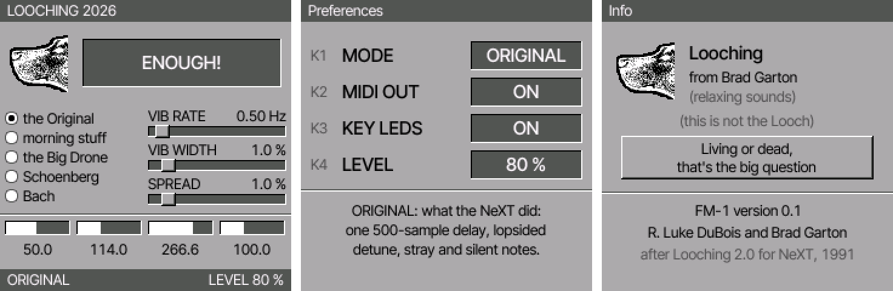

# Looching 2026

A revival of Brad Garton's 1991 NeXT drone generator **Looching** as custom firmware for the **M-VAVE FM-1** pocket
synthesizer: four slow wavetable voices on a lazy random scheduler, with the original's tone rows, timbres and quirks.

> "Looching" is a program which generates pseudo-NewAge (or perhaps it's the Real McCoy!) music using the Motorola
> DSP chip. I wrote it because I like to have long droning sounds going while I stare at error messages, read news,
> move windows around on the screen, etc. (Brad Garton, Columbia University Music Department, from the original README)

**Try it in your browser:** [the Looching 2026 emulator](https://claude.ai/artifact/PEsiVZXfoezkMuoeRzFwy3): press
*Switch on*, then **PLAY**, and give the drones a few seconds to arrive.

**Install it on your FM-1:** [the web installer](https://rev3rend.github.io/looching2026/webapp/installer/) (Chrome or
Edge, FM-1 connected by USB) writes the latest release. It can also return the FM-1 to the official firmware.



Version 1.0 ([release](https://github.com/rev3rend/looching2026/releases/tag/v1.0): `looching2026-1.0.fwsc`). It runs
on a real FM-1. What it does, in full: [docs/SPEC.md](docs/SPEC.md).

## What it does

Looching emulates the original NeXT program as closely as its source code allows (Objective-C on the NeXT
MusicKit: `Looching.m`, `Bark.m`, `LoochPerformer.m`, `RandomIzer.m`, `LoochWaves.h`):

- **Four voices**, each the original's "Bark" patch: two interpolating 64-sample wavetable oscillators (seven
  partials each, the original's tables), the second detuned by the spread, each with its own sine vibrato; a slow
  asymptotic envelope (attack and release T60 of 10 to 20 seconds); the left channel dry, the right through a short
  delay. Computed at the NeXT DSP's 22,050 Hz and upsampled.
- **The original's scheduler:** it wakes every 2 to 10 seconds; each free voice starts a note half the time, with a
  random wave from the timbre set, a random pitch from the tone row, and a length of 5 to 20 seconds.
- **Five tone rows**, each with its timbre set: *the Original* (just intonation), *morning stuff*, *the Big Drone*,
  *Schoenberg* ("the first hexachord of Arnie's 4th", in the original's help) and *Bach*.
- **ORIGINAL and INTENDED modes.** The 1991 code has bugs that shaped its sound: the delay meant to differ per voice
  is 500 samples for all four; the pitch picker can read one entry past a row (a stray 116.5 Hz in the Original,
  silent notes elsewhere); the detune is lopsided; a new timbre set only arrives after a restart. ORIGINAL keeps all
  of that, INTENDED plays what the code meant.

## Playing it

| Control | What it does |
| --- | --- |
| **PLAY** | RELAX / ENOUGH!: start and stop the drones |
| **PRESETS** | the tone row (the original's radio buttons) |
| **KNOB 1, 2, 3** | the original's sliders: vibrato rate limit (0 to 10 Hz), vibrato width limit and frequency spread (0 to 10 %); they shape the next notes |
| **KNOB 4** | output level (the MASTER pot too) |
| **ALGORITHM** | ORIGINAL / INTENDED |
| **SELECT** | the pages: MAIN, Preferences, Info |
| **GLO** | Preferences: mode, MIDI out, key lights, level |
| **EDIT**, or **HOME** held | Info: the original's Info panel |
| **HOME** | back to MAIN |
| **SAVE** | keep the settings; held: the original's defaults (not saved until SAVE) |
| the keys | play nothing: their lights show the pitches the voices sound |

The other buttons are kept for planned extras (note density, attack and release ranges, note length, wake-up
interval, delay mix, transposing the rows); for now they say what they will do. OCT− and OCT+ held together for
5 seconds is the platform's recovery mode.

## Accessibility

- **Screen reader:** the FM-1 speaks through [fm1-reader](https://github.com/charlesvestal/fm1-reader). It reads
  each page in full, says every control as it settles ("vibrato rate 0.55 hertz", "tone row, Schoenberg"), RELAX
  and ENOUGH!, and each note a voice starts ("voice 3, 266.6 hertz"), in full words.
- **MIDItoSpeech:** every control goes out over USB-MIDI on channel 1, and
  [docs/synthaccess/Looching2026.json](docs/synthaccess/) lets
  [synthaccess MIDItoSpeech](https://github.com/IDMNYU/synthaccess/tree/main/MIDItoSpeech) speak it on a computer.
  The file is generated from the firmware and checked against every value it sends.

## MIDI

The FM-1 shows up as **Looching FM-1**. Out over USB (MIDI OUT on, in Preferences):

- the drone: voices 1 to 4 on channels 1 to 4, each note as the nearest MIDI note with a pitch bend to the exact
  frequency (±2 semitones), so a DAW can double it;
- the panel, on channel 1: CC 7 level, NRPN 0:76 vibrato rate (14-bit), CC 77 vibrato width, CC 78 spread, CC 80
  mode, CC 81 key lights, CC 109 RELAX / ENOUGH!, Program Change 0 to 4 the tone row.

There is no MIDI in. Details: [docs/SPEC.md](docs/SPEC.md#midi).

## Installing

The easiest way: open [the web installer](https://rev3rend.github.io/looching2026/webapp/installer/) in Chrome or
Edge, connect the FM-1 by USB, press **Install**, and allow MIDI when the browser asks. It always offers the latest
release (each published release updates it: `.github/workflows/pages.yml`), and its *Return to official V15* puts
M-VAVE's firmware back.

From the command line instead: download `looching2026-1.0.fwsc` from the [release](https://github.com/rev3rend/looching2026/releases/tag/v1.0)
(check it against `SHA256SUMS`), connect the FM-1 by USB and, from a checkout of this repository:

```sh
python3 tools/fm1_install.py looching2026-1.0.fwsc   # needs mido and python-rtmidi
```

At power-on the bottom line shows `LOOCHING 2026 v1.0`. A build of your own is `build/firmware.fwsc`; to try the
installer page with it locally: `python3 web/make_site.py build/firmware.fwsc dev build/site`, serve `build/site` and
open `/webapp/installer/`. Read [Safety](#safety) first.

## Build and test

```sh
sh .claude/skills/fm1-platform/scripts/setup_env.sh --emsdk   # once: toolchain, SDK files, Emscripten
./build.sh                                                     # build/firmware.fwsc
tests/run_tests.sh                                             # host tests, screenshots in build/shots/
sh web/emu/build.sh && python3 -m http.server -d build/emu 8000   # the emulator: http://localhost:8000/
```

On macOS the JieLi toolchain runs in Docker. Details: [BUILDING.md](BUILDING.md). The tests check the sound (pitch,
level, clicks, the delays), the scheduler and every quirk statistically, the screens, the settings in flash, the
screen reader and the MIDI out. GitHub Actions runs them on every push.

```
firmware/
  hal/        header-only HAL: every register access lives here          (platform, from Felucca)
  loader/     the update loader that writes a new app                     (platform, from Felucca; do not touch)
  src/        boot, main loop, audio ISR, USB-MIDI, update entry, flash,  (platform)
              display and drawing, panel map, MIDI helpers, record store
  app/        Looching: data.c (settings), sound.c (voices, scheduler), ctl.c (MIDI out), ui.c (pages),
              sr.c and speak.c (screen reader)
assets/       looching/: the original's wavetable and pitch data and its icon; fonts/
docs/         SPEC.md (what the firmware does), synthaccess/ (the MIDItoSpeech file), images/
tests/        host tests: the platform's update path, input, USB, store; the app on a simulated FM-1
web/          the web installer (with "Return to official V15") and the browser emulator
tools/        build, package, install; gen_looch.py (the original's data), gen_synthaccess.c (the sidecar)
.claude/      Claude Code skills: fm1-platform (rules, budgets, tests, safety), graphify (code graph)
```

## Safety

The FM-1 has **one firmware bank and no recovery button**. A firmware that does not start needs extra hardware to
recover. So the working order is always **host tests → browser emulator → careful install**, never the reverse.

- The platform keeps the ways back: the boot guard sends the unit to the chip's boot mode (`WL80UBOOT`) after two
  failed boots; OCT− and OCT+ held 5 s does the same on purpose; the update entry accepts a new package over USB
  while the firmware runs. Do not remove or bypass them, and do not change `firmware/loader/`, the boot guard, the
  package identity (`FM-1_900`) or the update path.
- For a changed build, have the recovery hardware at hand:
  [FM-1-transporter](https://github.com/kurogedelic/FM-1-transporter) (a Seeed XIAO RP2040 on the FM-1's USB lines,
  which reads and writes the flash from the boot mode). Back up the flash first.
- Way back while a firmware still starts: `python3 tools/fm1_install.py --stock`, the web installer's "Return to
  official V15", or M-VAVE's own updater.

## Credits and licence

- **Looching** (1990–91, NeXT): Brad Garton, Columbia University Music Department. "Looch" is the name of his dog
  (the icon, as its Info panel says, is not the Looch). Its wavetables, tone rows and icon are used here with his
  agreement, under this firmware's licence.
- **Looching 2026:** R. Luke DuBois and Brad Garton.
- **The platform:** [Felucca](https://github.com/hugelton/Felucca) by Leo Kuroshita (Hügelton Instruments), as
  [M-Vave-OP1](https://github.com/janschulten/m-vave-op1) runs it (the FM-1 Firmware Kit); the browser emulator after
  charlesvestal's [X0X](https://github.com/charlesvestal/fm1-x0x).

GPL-3.0-only, as Felucca. Copyright (C) 2026 R. Luke DuBois and Brad Garton; the platform: Leo Kuroshita (Hügelton
Instruments) and the M-Vave-OP1 contributors. Keep the licence headers, credit Felucca (and M-Vave-OP1) wherever you
publish, and give your users the source. Details and third-party parts: [LICENSING.md](LICENSING.md).

M-VAVE and FM-1 are trademarks of their respective owners. This firmware is not affiliated with or endorsed by them,
nor by Hügelton Instruments.
